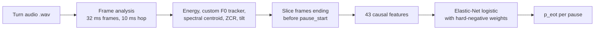

# Turn-Taking Without Words: End-of-Turn Detection from Prosody

**A causal, audio-only model that tells a voice agent when the user has finished speaking, in English and Hindi, without ASR, without pretrained weights, and without looking into the future.**


---

## The problem

A voice agent that waits for silence is either **slow** (it waits too long after every sentence) or **rude** (it barges in while you pause to think). The real question at each pause is:

> *Is this person done, or just taking a breath?*

Given a recording and the timestamps of every pause in it, the model outputs `p_eot`, the probability that the pause is the **end of the turn** rather than a **hold**. It can only use audio from **before** the pause starts, exactly as a live system would.

## Results

The score is the **mean response delay on true turn ends, subject to interrupting at most 5% of turns**, as computed by the official scorer. Lower is better.

| | English | Hindi |
|---|---:|---:|
| Silence-only baseline | 1600 ms | 850 ms |
| **This model: official `score.py`** on the provided data | **1015 ms** (−37%) | **831 ms** |
| **This model: grouped 5-fold CV** (estimate for unseen turns) | **1248 ms** (−22%) | 850 ms |

Both rows are reported on purpose. The official number comes from the shipped model refit on all of the provided data. The cross-validation number never lets a turn appear in both train and test, so it is the more honest estimate of how the model generalises. On English, both show a clear gain. On Hindi, the cross-validated model only matches the silence baseline, which is explained in [Where it fails](#where-it-fails).

## How it works



### 1. Signal processing from scratch
`eot_features.py` runs one pass of per-frame analysis over each turn: energy in dB, a vectorised **normalised cross-correlation pitch tracker** with octave correction and median smoothing, spectral centroid, zero-crossing rate, and spectral tilt. Only NumPy is used, with no pretrained models and no external DSP libraries.

### 2. 43 strictly causal features
For each pause, only frames that end **at or before** `pause_start` are used. The current pause's duration is future information, so it is never a feature.

| Group | What it captures |
|---|---|
| **Pitch** (semitones, normalised to the speaker's own range) | Final fall or rise, boundary-tone shape, how close the last pitch is to the speaker's floor or ceiling |
| **Energy** | Fade-out, final drop, slope over the last 300 to 500 ms |
| **Voicing and timing** | Final-syllable lengthening, speech rate, voiced fraction, creak |
| **Spectral** | Centroid, zero-crossing rate, and tilt at the end of speech |
| **Turn context** | Pause position, durations of *previous* pauses, speech so far |
| **Acoustic completion** (4 features) | An AR(2) model is fit on the energy and pitch contours, and its residual "surprise" on the final frames acts as a stand-in for "does this phrase sound finished?" without needing ASR |

### 3. Optimise the metric that actually matters
The key insight came from reading the scorer: a hold only counts as a false cutoff if the agent fires **before the user resumes**, which means `delay < pause duration`. **Short holds are free.** The model only has to rank true turn ends above *long* holds.

That changed the whole approach:
- **Hard-negative weighting.** Holds longer than 0.8 s, the only ones that can actually cause a cutoff, get 12× sample weight.
- **Model selection uses the official threshold-and-delay sweep, not AUC.** Several models with *better* AUC (RBF-SVM, MLP, gradient boosting) scored *worse* on the real metric, and AUC-driven feature selection was rejected because it raised AUC but hurt the score.
- **Hindi-priority selection.** The hidden test set was expected to be mostly Hindi, so candidates were ranked by `(English + 2 × Hindi) / 3`.

### 4. The final model
A single joint English and Hindi pipeline: median imputation, standard scaling, and an **Elastic-Net logistic regression** (`C=0.5`, `l1_ratio=0.5`). Language is not an input feature. All model decisions were made with `GroupKFold(5)` by `turn_id`, then the final model was refit on all data.

## Experiments

Ten logged rounds. Full details are in [`RUNLOG.md`](RUNLOG.md), and every script and raw log is archived in [`experiments/`](experiments/README.md).

| Round | Change | English CV | Hindi CV | Outcome |
|---|---|---:|---:|---|
| 0 | Silence-only baseline | 1600 | 850 | Reference |
| 1 | 31 prosodic features with logistic regression | 1235 | 865 | Logistic regression beats gradient boosting |
| 3 | Joint English and Hindi training | 1171 | 857 | Shared data helps English |
| 4 | Feature selection by AUC | 1360 | 850 | **Rejected**: AUC went up, score went down |
| 7 | 9-model bake-off (Elastic-Net, SVMs, LDA/QDA, MLP, HGB, …) | — | — | Elastic-Net wins on the real metric |
| 8 | + 4 acoustic-completion features | **1134** | 850 | Best cross-validated English |
| 9 | Tiny BiGRU over the last 0.8 s of pitch and energy | 1172–1470 | 850–857 | **Rejected**: never safely beat the tabular model |
| 10 | Hard-negative weights on long holds | 1248 | 850 | Official score **1015 / 831**; shipped |

## Where it fails

Hindi's longest holds are **prosodically complete clauses followed by a thinking gap**. They have deep final pitch falls and large energy drops, and they sound *more* finished than many real turn ends. Listening to the worst cases confirmed it: for holds longer than 0.8 s, `AUC(end of turn vs long hold) ≈ 0.45`, which is worse than chance.

I checked that this is a real ceiling and not a pipeline bug by running adversarial predictions through the official scorer:

| Predictions | Hindi score |
|---|---:|
| Oracle (perfect labels) | 100 ms |
| Never fire | 1600 ms |
| Always fire (silence baseline) | 850 ms |
| Random scores | 872 ms |
| Shipped model, with just the 5 longest holds zeroed out (counterfactual) | **736 ms** |

The scorer works, and the bottleneck is the ranking of about five pauses. Telling "trailing off to think" from "trailing off because I'm done" ultimately needs the words.

**Next steps:** per-language calibration on top of the joint model; syllable-nucleus and phone-rate dynamics over a longer context window; and collecting Hindi turns with deliberate mid-clause versus final pauses so a small temporal model has enough signal to learn the difference.

## Quickstart

> **Data note:** the audio and the official scorer were provided as part of an assessment handout and are **not redistributed** here. Predictions for the provided sets are included in `predictions_english.csv` and `predictions_hindi.csv`.

```bash
pip install numpy pandas soundfile joblib "scikit-learn>=1.8"
```

The shipped `eot_model.pkl` was saved with scikit-learn 1.9, so older versions will warn when they unpickle it.

**Predict** on any folder containing `labels.csv` and an `audio/` directory:

```bash
python predict.py --data_dir path/to/data --out predictions.csv
```

`labels.csv` needs the columns `turn_id, audio_file, pause_index, pause_start, pause_end`. A `label` column (`hold` or `eot`) is optional. The output has the columns `turn_id, pause_index, p_eot`.

**Retrain** with the data in `eot_handout/eot_data/{english,hindi}/`:

```bash
python train_model.py          # prints grouped-CV scores and writes eot_model.pkl
```

## Repository layout

```
├── eot_features.py           # Frame-level DSP + 43 causal pause features
├── eot_data.py               # labels.csv + wavs -> feature matrix (shared by train/predict)
├── train_model.py            # Grouped CV, official-metric evaluation, final fit
├── predict.py                # Inference interface: data folder -> p_eot CSV
├── eot_model.pkl             # Shipped model
├── predictions_english.csv   # Predictions for the provided English set
├── predictions_hindi.csv     # Predictions for the provided Hindi set
├── NOTES.md                  # Short design summary
├── RUNLOG.md                 # Every run, every score, and the audit
└── experiments/              # Research trail: scripts and raw logs for every round
```

## Constraints this was built under

- **Strict causality.** No audio at or after `pause_start` is used, and the current pause's duration is never a feature.
- **No ASR and no pretrained weights.** Everything is trained from scratch on 200 turns (496 pauses).
- **Small data.** 100 turns per language, with exactly one turn end per turn, so every decision went through grouped cross-validation.

---

*Built as a take-home speech AI assignment for [Plivo](https://www.plivo.com/).*
